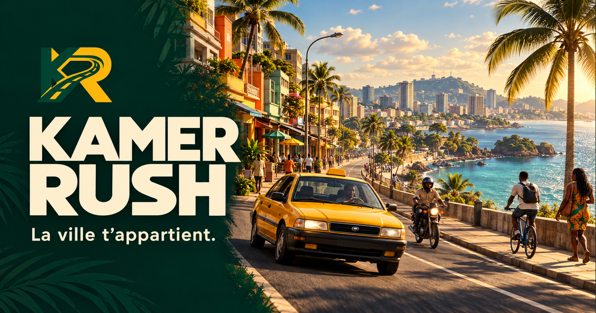

# Kamer Rush

**La ville t’appartient.** Explore an original fictional city inspired by Douala, walk, run, swim in the bounded beach cove, switch to a bicycle, a motorcycle and an urban taxi, and earn a reputation through passenger missions.

This is a **local playable prototype**, prepared for public source hosting. A project license has **not yet been chosen**; see [LICENSING.md](LICENSING.md). No public repository, deployment, account system or commercial service is included.



_AI-generated promotional illustration; not a gameplay screenshot._

[Guide en français](docs/guide.fr.md) · [Architecture](docs/architecture.md) · [Contributing](CONTRIBUTING.md) · [Verification](docs/testing.md)

## Run locally

Prerequisites: Node.js **20.15.0 or newer** and npm. Development and checks were executed on macOS with Node 20.15.0 / npm 10.7.0. Other Node versions and operating systems have not been independently tested. A recent browser with WebGL is required.

```sh
npm ci
npm run dev
```

Open the URL printed by Vite, normally `http://127.0.0.1:5173`. The server binds to loopback only. To stop it, press Ctrl+C in that terminal. Use the committed lockfile with `npm ci`; no credentials or environment variables are needed.

```sh
npm run typecheck
npm test
npm run build
npm run preview
npm run format:check
```

`build` runs TypeScript checking and creates the static production files in `dist/`. `preview` serves that build locally (normally port 4173). `dev` is the editing server. The visual model fixture is at `/scale.html` on either server. See the [command and test matrix](docs/testing.md).

## What is playable

- A connected, approximately **644 × 644 m** bounded area with five fictional sectors, several hundred procedural buildings, gardens, a beach/promenade, original animated water and six landmarks. This is not a geographic reproduction of Douala.
- Walking, a pedal-driven bicycle, a motorcycle and a yellow taxi. Park at a complete stop, use an animated transition into a checked clear position, walk around the parked vehicles and get back in. Vehicles retain their positions during normal play.
- Six passenger missions, playable with the motorcycle or taxi; the bicycle is for exploration. The first is a short introduction; later destinations cross sectors. Time, comfort and successful arrival determine reputation and earnings.
- Moving pedestrians on constrained sidewalk segments, taxis and delivery trucks on predetermined traffic loops. Trucks are scenery/traffic, not controllable vehicles.
- An original rectangular local minimap using the same street widths and collision footprints as the world, a smooth heading rotation, north marker, current objective and parked vehicle icons; `M` opens the whole city map.
- Pause, retry, next mission, local progression, optional synthesized effects, 40 original dialogue texts with subtitles and included ElevenLabs-generated recordings, custom accessible settings and three quality settings. The UI uses official Lucide SVG icons.

Walking and cycling currently support exploration and vehicle switching. Passenger transport requires a motorcycle or taxi; there are no separate walking missions.

## Controls

| Action                         | Keyboard                                 | Touch / pointer             |
| ------------------------------ | ---------------------------------------- | --------------------------- |
| Forward / accelerate           | W, Z, Up                                 | Hold up pedal               |
| Backward / reverse             | S, Down                                  | Hold down pedal             |
| Turn                           | A/Q/Left, D/Right                        | Hold left/right             |
| Brake vehicle                  | Space                                    | Hold brake icon             |
| Pick up / drop off             | E, near the objective and nearly stopped | Context button              |
| Exit / board parked vehicle    | F                                        | Vehicle context button      |
| Whole city map                 | M                                        | Map icon                    |
| Pause / resume                 | P, Escape                                | Pause icon                  |
| Sprint / stronger acceleration | Hold Shift                               | Hold lightning plus forward |
| Swim recovery                  | R, while swimming                        | Return to beach button      |
| Horn, motorcycle / taxi        | H                                        | Horn button                 |
| Recenter camera                | C                                        | —                           |

On foot, turning changes facing direction and forward/backward moves along it. The driving model is arcade steering rather than a physical motorcycle simulator. Arrow keys also work on AZERTY keyboards. Losing window focus pauses the game and clears held inputs.

## Mission loop and persistence

Choose any of the six departure missions on the welcome screen, enter the city, and explore freely before picking up the waiting client, then stop within 6 m of the yellow objective and use **E**. The deadline starts after the passenger finishes boarding. Each collision costs 22 comfort points; a hard brake from more than 12 m/s costs 4, with cooldowns. A mission fails at its individual minimum comfort or when its time expires. There is no timer while looking for the first pickup.

The result shows the actual earned amount, comfort and remaining time. Successful missions add 1–3 reputation points and fictional in-game F. Retry restarts the current mission; Next starts the next one and places all three controllable vehicles near its pickup. Restart intentionally resets their positions; ordinary exit/boarding does not.

Totals are stored only in browser `localStorage` under `kamer-rush-v1`. They belong to the browser and origin/port. See [saving and resetting](docs/architecture.md#saving-and-resetting). There are no network accounts, analytics, payments, purchases or multiplayer.

## Documentation

- [Audio, casting, event wiring and rights](docs/audio.md)
- [French player guide](docs/guide.fr.md)
- [Runtime, states, coordinates, collisions, NPCs and persistence](docs/architecture.md)
- [Add a mission, sector, vehicle or asset](docs/extending.md)
- [Testing matrix and reproducible manual checks](docs/testing.md)
- [Branding, OG and sitemap configuration](docs/branding.md)
- [Reference review and reuse decisions](docs/references.md)
- [Performance choices and remaining limits](docs/performance.md)
- [Known limits and possible next work](docs/roadmap.md)
- [Dependency and asset provenance](THIRD_PARTY.md), [dependency inventory](THIRD_PARTY_DEPENDENCIES.json)
- [License decision](LICENSING.md) and [publication checklist](docs/releasing.md)

World geometry, maps and synthesized effects are procedural; dialogue MP3s were generated with ElevenLabs and included with the owner’s explicit redistribution authorization; they retain rights separate from the code; the brand logo and promotional illustration are AI-generated, with preserved originals and provenance. Private reference screenshots are excluded from distribution and version control. No code, texture, model, map, HUD or music from reference games is bundled.

## Included voice recordings

A clone includes all 40 generated dialogue MP3s, activated by default after you enable sound. No ElevenLabs account, API key, local catalog or environment flag is needed. Subtitles remain independently available. See [audio integration and provenance](docs/audio.md) and the [separate audio notice](public/audio/AUDIO-NOTICE.md). No third-party music is included.
